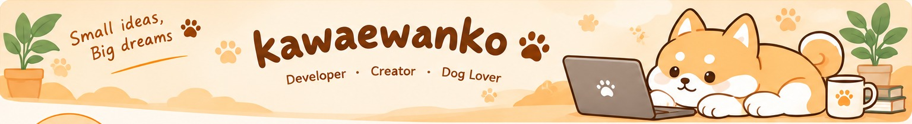

# Mabu

### Build. Learn. Make things a little better.

A developer based in Takasaki, Gunma, who loves dogs and making things. 
I build useful, playful projects that are worth coming back to.

[🇯🇵 日本語](README.md) · [🇺🇸 English](README.en.md)

---

## How I build

- 🛠️ **Learn by building** — Turn experiments into the next improvement
- 🌱 **Start small** — Grow ideas into things people can actually use
- 🐾 **Care and play** — Take the craft seriously while leaving room for fun

## Links

🌐 [Website](https://kawaewanko.pages.dev/) · 𝕏 [@xx_mabu_xx](https://x.com/xx_mabu_xx)

## Featured projects

These are provisional selections from my currently public repositories. I'll update this section as the projects take shape.

| Project | Description | Language |
|:--|:--|:--|
| [mogkoe](https://github.com/kawaewanko/mogkoe) | Project in progress |  |
| [discord-voicevox-yomiage](https://github.com/kawaewanko/discord-voicevox-yomiage) | Project in progress |  |
| [nextjs-portfolio](https://github.com/kawaewanko/nextjs-portfolio) | Portfolio |  |

## Technologies & tools

A mix of technologies I use today and want to keep exploring.

## GitHub activity

 

  

These cards are generated by external services and change with public repositories and activity.

## Contribution animation

<picture>
  <source media="(prefers-color-scheme: dark)" srcset="https://raw.githubusercontent.com/kawaewanko/kawaewanko/gh-pages/github-contribution-grid-snake-dark.svg">
  <source media="(prefers-color-scheme: light)" srcset="https://raw.githubusercontent.com/kawaewanko/kawaewanko/gh-pages/github-contribution-grid-snake.svg">
  
</picture>

## What's next

I previously worked under [@inumabu](https://github.com/inumabu). I'm building on that experience and starting a new chapter here—one small, thoughtful project at a time.

---

**Thanks for stopping by.**

Built with curiosity, care, and a little playfulness. 🐾

[🇯🇵 日本語で読む](README.md) · [⬆ Back to top](#mabu)

